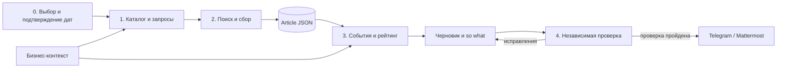

# Архитектура

## Поток данных



## 0. Период: первый шаг пользовательского запуска

При запросе «за последнюю неделю» показать точные границы предлагаемого окна последних 7 дней по Москве и спросить «да/нет». При «да» использовать предложение; при «нет» запросить свои даты начала и окончания включительно. Длительность пользовательского периода не ограничивается неделей. Явно заданные пользователем точные даты являются выбором без дополнительного диалога. Без ответа сбор не начинается. Манифест фиксирует границы, часовой пояс, время и способ выбора. Автоматический запуск без диалога требует отдельно согласованной политики периода. CLI реализует выбор; поиск и последующие стадии пока не реализованы.

## 1. Discovery: кого и что искать

Вход: бизнес-контекст, golden set, подтверждённый период и версионируемые конфиги. Реализован генератор `plan-search`: запросы по компаниям, тематикам, источникам и независимо по новым механикам. Tinder, Badoo, Bumble, Hinge, Grindr и компании всех 10 примеров обязательны для поиска и сохранения до отбора top-10. Неизвестный официальный домен не отключает обязательную компанию. Широкий запрос по компании не требует запуска новой функции; тематические запросы дополняют его. Смежные организации ищутся только в dating-контексте. Каталог v1 и статусы источников описаны в `monitoring-catalog.md`. Новые компании из открытого поиска сохраняются кандидатами с подтверждениями. План фиксирует настройки и ожидаемое покрытие, но исполнение и проверка реального recall ещё предстоят.

## 2. Ingestion: найти и сохранить

Адаптеры поиска/RSS/API находят ссылки; адаптеры загрузки извлекают тело статьи, заголовок, автора при наличии и даты. Поисковый сниппет не считается полным текстом. Сохраняются URL, канонический URL, точное время сбора, исходный текст, его хеш, язык, метод и статус извлечения. Если полный текст недоступен, статус и причина сохраняются явно; такой материал сам по себе не подтверждает факт запуска.

`published_at` — дата публикации источника, `event_date` — дата события, `collected_at` — время загрузки. Окно строго `[window_start, window_end_exclusive)` из подтверждённого манифеста. Предложение последних 7 дней не применяется без выбора пользователя. Свои даты включают оба полных дня по Москве; технический конец — полночь следующего дня. Неизвестная дата остаётся `null`; точность хранится отдельно. Неоднозначные относительные даты не преобразуются без основания. Если известен только день и он пересекает частичную границу окна, требуется уточнение: техническая полночь не доказывает актуальность. Перекрытие поиска нужно для индексации и не расширяет окно включения. Дополнительно требуется новый факт: свежий пересказ старого запуска исключается. Новое объявление будущего запуска допустимо с явным статусом анонса.

Дубли URL устраняются при сборе. Дубли событий объединяются далее: одна функция, рынок, стадия и компания могут фигурировать в нескольких статьях. Новый этап rollout или другой рынок может быть самостоятельным событием, если добавляет существенный факт.

## 3. Editorial: от материалов к решениям

Сначала определить одну из семи категорий по `config/editorial_policy.json`. Для продуктовых категорий требуется изменение функции/тарифа/правил, новая механика либо применимый сигнал безопасности из примеров. Для финансов/сделок/назначений и маркетинга продуктовая часть не обязательна: нужны новизна, значимость и конкретная польза для Lovito/биздева. Слух, анонс, beta и доступный запуск различаются. Общие советы о знакомствах и повторные пересказы не проходят. Малые компании допускаются только с подтверждённой новой механикой; финансирование без связи с новым продуктом не подходит этому разделу.

Единица ранжирования — событие (`event`), не статья. Оно хранит источники и подтверждения. До рейтинга проверяются соответствие категории, дата в окне, новый подтверждённый факт, источник, отсутствие дубля и связь с контекстом. Пять критериев: релевантность бизнесу, новизна информации, применимость, качество доказательств, рыночная значимость; шкала 0–5, итог = сумма(оценка / 5 × вес) × 100. Новизна трактуется внутри категории: финансовая новость не требует запуска функции. Начальные веса требуют калибровки. Пробелы не заменяются выдуманными оценками. При равенстве выше качество подтверждения, затем дата и стабильный ID.

Сначала выбираются до 10 событий глобально, затем группируются в семь разделов без квот. `rank` хранит глобальный приоритет, `display_order` — сквозную нумерацию поста после группировки. Это преобразование отображения не является изменением рейтинга; перестановка приоритетов требует обоснования. Одно событие имеет один основной раздел и дополнительные tags. Разные события из одного отчёта допустимы, но одинаковые факты не дублируются. Пустой раздел содержит «За выбранный период значимых новостей нет.»; при сбое сбора — отдельное сообщение о недостатке данных. История выпусков предотвращает повторы; существенное обновление связывается с предыдущим событием.

So what состоит из: сигнала рынка, связи с конкретной задачей MVP, проверяемой гипотезы/действия и ограничения применимости. Не утверждаем рост конверсии или возможность реализации без данных. Если контекст не подтверждает наличие функции у Авито, формулировка остаётся условной. Каждый тезис о внешнем событии опирается на источник; вывод для Авито явно обозначается как аналитический.

## 4. Publishing: проверить и доставить

Отдельный проход проверки получает черновик, контекст, рейтинг и подтверждения. Он проверяет факты, даты, стадии запуска, уникальность, порядок, полезность so what, язык, длину и ссылки. Детерминированные проверки отвечают за JSON, счётчики, обязательные поля, порядок и ограничения канала; LLM — за смысл и соответствие доказательствам. Замечания имеют тяжесть и адресата. Блокирующие замечания запрещают доставку; после лимита исправлений запуск завершается с сохранённым черновиком и отчётом.

Рендереры Telegram и Mattermost независимы. Лимиты и особенности API проверяются при реализации интеграции. Если пост делится на сообщения, набор сохраняет нумерацию, порядок и ссылки. Повторная отправка использует ключ `digest_id + revision + channel + destination`; сохраняются внешние ID каждого сообщения. При неоднозначном сетевом результате сначала сверяем состояние, не отправляем вслепую повторно. Исправление доставленного выпуска — отдельная ревизия.

Автоматическая публикация возможна после настройки интеграции и успешной проверки. Начальный режим — dry run, пока нет целевого канала и редакционных критериев.

## Хранение и воспроизводимость

```text
data/runs/<run_id>/
  manifest.json                 окно недели и состояния стадий
  config_snapshot/              настройки, версии контекста и промптов
  raw/                          исходные ответы и загрузки при доступности
  articles/<article_id>.json    нормализованные статьи
  events/<event_id>.json        объединённые события и подтверждения
  ranking.json                  оценки всех кандидатов и причины отсевов
  digest.json                   структурированный выпуск
  rendered/                     готовые сообщения конкретного канала
  review.json                   замечания и результат проверки
  delivery.json                 ключи доставки, попытки, внешние ID
  logs.jsonl                    этап, статус, длительность, ошибка
```

Все файлы UTF-8. Секреты не попадают в снимки настроек и журналы. Исходные данные не перезаписываются при редакционном исправлении. Запись JSON через временный файл и атомарную замену; один активный писатель на запуск. Для параллельных запусков и истории доставки позднее выделяется SQLite-репозиторий с уникальными ключами.

Манифест фиксирует ошибки отдельных источников и долю покрытия: отсутствие новостей отличается от сбоя сбора. Ошибка одного источника не обрушает сбор целиком; недостаточное покрытие должно быть заметно в отчёте и учитываться перед публикацией. Метрики: найдено/загружено/отобрано, причины отклонений, дубли, покрытие компаний и языков, время, стоимость LLM, результат доставки.

## Технологический старт

Python 3.11+, локальные JSON-файлы и CLI. Адаптеры поиска, LLM и каналов сменные; поставщиков выбираем после уточнения доступов. Сначала ручной сквозной dry run на фиксированном наборе примеров, затем реальные источники и расписание. Планировщик вызывает тот же pipeline; выбор Windows Task Scheduler/серверного cron/другого оркестратора зависит от места эксплуатации.
