# Архитектура

## Рабочий маршрут

```mermaid
flowchart LR
    U[Выбор периода] --> M[manifest + снимки конфигов]
    M --> D[discovery.build_plan]
    D --> P[search_plan.json]
    P --> S[Сбор в сессии: внешний шаг]
    S --> H[extract-page: общий обработчик HTML]
    H --> V[Проверка текста, дат и тематических тегов]
    V --> A[archive-articles: общий архив]
    A --> Q[qa-research: локальный аудит корпуса]
    Q --> R[review-research: источники и пропуски в сессии]
    R --> G[check-research-qa: текущий отпечаток и решение]
    G --> E[select-and-rank: только допустимые статьи]
```

CLI в `__main__.py` связывает диалог `orchestration.period`, правила дат `domain.window`, контекст `domain.context` и генератор `discovery.plan`. CLI не вызывает сеть и LLM: первые две команды готовят план, сбор выполняется по prompts/collect-news-fast.md, archive-articles сохраняет готовые карточки.

`init-run` v0.5 фиксирует семь конфигов, context_bundle и канонические SHA-256. Папка становится доступной после записи всех файлов через временный каталог. `plan-search` сверяет снимки и контекст с манифестом; текущий config влияет только на новые запуски. Для планирования нужны манифест v0.5 и снимки с research_policy, search_intents и external_search. Старые форматы требуют нового запуска; чтения текущего каталога вместо отсутствующего снимка нет. Готовый план не перезаписывается.

Fast-план v1.1 разделяет queries (возможные обращения с устойчивыми ID) и search_tasks (задания по уникальному тексту и phase). Сначала source_indexes проверяются по трём направлениям — запуски, фичи/тарифы, кампании; first_pass содержит открытый поиск событий и внешних интервью/результатов на RU/EN, if_gap — условные уточнения для компаний всех рынков. discovery.queries.build_followup_query использует замороженный словарь intent и синонимов, поддерживает company_id и новое company_name, возвращает исключения официальных доменов. Журнал raw/source_reviews.jsonl фиксирует достигнутый период и состояние ленты по шаблону review каждого индекса. Финансы/риски идут дополнительным потоком, словарь 14 моделей не задаёт квоту запросов. Матрицы покрытия: компания × язык и источник × направление. Exhaustive сохраняет прежний широкий план v0.9 для сравнения. Подробности — [event-focused-research.md](event-focused-research.md). search_priority задаёт порядок: официальные страницы для медиа/инвесторов, другие официальные источники, ключевые СМИ по словам из source_policy, широкий поиск. Проверка СМИ не отменяется найденным пресс-релизом. В language_variants каждого задания сохранены все связанные query_id; результат одного языкового обращения переиспользуется для этих целей. Разные языки выполняются отдельно, кроме провайдеров с явной поддержкой поиска по всем запрошенным языкам вместе. language_request_count показывает число раздельных языковых обращений до такого объединения, а не измеренную стоимость поиска. Адаптер учитывает период, провайдера, регион, пагинацию и остальные параметры; task_id не заменяет полный ключ обращения. Старые планы остаются неизменными.

Единственный генератор строит fast-план для common.md + collect-news-fast.md. CLI `plan-search --run-dir ...` не выбирает стратегию, Python API `build_plan` тоже не принимает переключатель. WorkLedger связывает все известные redirect/canonical с одной записью и сохраняет успешную загрузку при поздней ошибке другого обработчика. checkpoint сериализует пакет до открытия файла и защищает добавление от перемешивания потоками одного процесса; межпроцессной блокировки и гарантии целостности пакета при сбое диска пока нет.

## Следующие этапы

После сохранения всех Article работает [QA исследования](research-qa.md). `prepare-editorial` проверяет исследовательский допуск и сохраняет входы и снимки промптов четырёх последовательных шагов. `check-editorial` сверяет Event, рейтинг, саммари и Digest с источниками и контекстом, `render-digest` формирует Markdown после Review точной ревизии. Смысловые шаги выполняет агент в сессии. Явно запрошенный режим черновика использует eligible при ограниченном покрытии и сохраняет статус draft. [Контракты редакционного маршрута](editorial-workflow.md).

| Этап | Вход → выход | Ответственность |
| --- | --- | --- |
| Ingestion | План → Article JSON и фактическое покрытие | Поиск/RSS/API, загрузка, извлечение, нормализация, повторы |
| Editorial | Статьи + контекст + история → Event, ranking, Digest | Объединение событий, допуск, рейтинг, отбор, so what |
| Review | Ревизия выпуска + доказательства → Review | Программная проверка контрактов и независимая смысловая рецензия |
| Publishing | Проверенная ревизия → сообщения и квитанции | Рендеринг, разбиение, доставка и восстановление |

Редакционные форматы и перекрёстные проверки исполняются локальным CLI. Рендеринг реализован для Mattermost Markdown. Сетевой сбор, автономный вызов моделей, доставка и расписание остаются следующими интеграциями.

Для сохранённого HTML уже работает общий `ingestion/pages.py` и команда `extract-page`: заголовок по нескольким сигналам, очистка служебных блоков/повторов, проверка качества текста и тематические tags без типа страницы. Даты, компании и теги проверяет сессия. Подключение к текущему маршруту и ограничения — в [обработке страниц](page-extraction.md). Сетевой Ingestion и объединение событий ещё не автоматизированы.

## Сквозные контракты

- Единое окно из manifest: [start, end), Москва. published_at — публикация, event_date — событие, collected_at — загрузка. Неизвестное остаётся неизвестным; день на частичной границе требует уточнения. Перекрытие поиска не расширяет окно допуска.
- Все подходящие материалы обязательного покрытия сохраняются до top-10. Явные сравнения/рейтинги/руководства отсекаются до загрузки по candidate_filter, URL/title и причина остаются в raw/rejected_materials.jsonl; сомнительное требует текста. Краткие события пишутся в raw/event_candidates.jsonl и не заменяют Article/Event. Сниппет не заменяет текст. Article хранит оригинал, URL/канонический URL, язык, точность даты, метод/статус извлечения и хеш. Ошибка источника отличается от отсутствия результатов.
- Ранжируется событие. Существенный новый rollout/рынок может быть отдельным событием. История выпусков связывает обновления с предыдущим событием. В Mattermost rank и display_order совпадают с порядком приоритета.
- Article хранит исходные title/text и язык публикации. При смысловой обработке формируется отдельный Event с русскими headline/facts[].claim; evidence_quote сохраняется на языке оригинала и ссылается на Article. Article и Event читаются/пишутся в UTF-8 через общий dating_digest.io; русская карточка не перезаписывает исходник. Смысловой этап пока выполняется в сессии по промпту.
- Политики читаются из снимка запуска. Предоставленный контекст Lovito используется при стратегическом отборе, написании so what и рецензировании. Поиск сохраняет широкий охват. Факты контекста сохраняют заданные статусы. Применение — в [интеграции контекста](context-integration.md). Агент получает common.md, промпт этапа и необходимые артефакты из редакционного снимка.
- Review относится к точной revision; blocking запрещает доставку. Число исправлений ограничивается. После изменения текста проверка повторяется.
- Доставка хранит ключ digest_id + revision + channel + destination и ID каждого сообщения. Неоднозначный сетевой результат сначала сверяется; исправление опубликованного выпуска создаёт новую ревизию.

## Артефакты

Постоянные статьи находятся в `article/YYYY/MM/DD.MM.YY/`, правила дублей/версий — в [архиве](article-archive.md). В `data/runs/<run_id>/` создаются manifest.json, context_bundle.json, config_snapshot/, raw/, articles/ и search_plan.json. Редакционный этап добавляет editorial/inputs.json, news.json, analysis.json, summaries.json, снимки промптов и отчёты проверок, events/*.json, ranking.json, digest.json, review.json и rendered/mattermost.md. Квитанция рендеринга сохраняется в editorial/render.json. Журнал сетевой доставки относится к будущему Publishing.

Файлы UTF-8, секреты вне артефактов. CLI проверяет связность конфигов и соответствие разделов/весов схемам. Общая реализация JSON I/O — `dating_digest/io.py`. Неизменяемые файлы публикуются атомарно: временный файл на том же диске, flush/fsync, затем hard link с запретом замены существующего файла; временный каталог удаляется и при ошибке. Нужна поддержка hard links. Архив уже использует SQLite для конкурентных записей и связей с источниками; изменяемые отчёты заменяются явно. Для остальных этапов ещё нужны сохранение состояния и возобновление. Ошибки и покрытие должны быть видны в отчёте; метрики — объём сбора/отбора, причины отклонений, время, стоимость и доставка.
