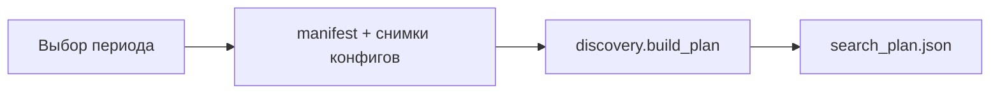

# Архитектура

## Реализованный путь

CLI в `__main__.py` связывает диалог `orchestration.period`, правила дат `domain.window`, контекст `domain.context` и генератор `discovery.plan`. Сеть и LLM не вызываются; статусы остаются planned.

`init-run` v0.5 фиксирует семь конфигов, context_bundle и канонические SHA-256. Папка становится доступной после записи всех файлов через временный каталог. `plan-search` сверяет снимки и контекст с манифестом; текущий config влияет только на новые запуски. Старые манифесты v0.3/v0.4 используют текущий каталог с предупреждением. Неизвестные версии отклоняются; готовый план не перезаписывается.

## Следующие этапы

| Этап | Вход → выход | Ответственность |
| --- | --- | --- |
| Ingestion | План → Article JSON и фактическое покрытие | Поиск/RSS/API, загрузка, извлечение, нормализация, повторы |
| Editorial | Статьи + контекст + история → Event, ranking, Digest | Объединение событий, допуск, рейтинг, отбор, so what |
| Review | Ревизия выпуска + доказательства → Review | Программная проверка контрактов и независимая смысловая рецензия |
| Publishing | Проверенная ревизия → сообщения и квитанции | Рендеринг, разбиение, доставка и восстановление |

Это проектируемые интерфейсы. Форматы заданы в `schemas/`, редакционные правила — в конфиге; промпты не заменяют программные проверки. Модели поиска и LLM, каналы и расписание пока не выбраны.

## Сквозные контракты

- Единое окно из manifest: [start, end), Москва. published_at — публикация, event_date — событие, collected_at — загрузка. Неизвестное остаётся неизвестным; день на частичной границе требует уточнения. Перекрытие поиска не расширяет окно допуска.
- Сначала сохраняются все материалы обязательного покрытия. Сниппет не заменяет текст. Article хранит оригинал, URL/канонический URL, язык, точность даты, метод/статус извлечения и хеш. Ошибка источника отличается от отсутствия результатов.
- Ранжируется событие, не статья. Существенный новый rollout/рынок может быть отдельным событием. История выпусков связывает обновления с предыдущим событием. Глобальный rank отделён от display_order после группировки.
- Контекст и политики читаются из снимка запуска. Применение и ограничения — в [интеграции контекста](context-integration.md). LLM получает common.md, промпт этапа и необходимые артефакты; версии промптов предстоит фиксировать при подключении исполнителя.
- Review относится к точной revision; blocking запрещает доставку. Число исправлений ограничивается. После изменения текста проверка повторяется.
- Доставка хранит ключ digest_id + revision + channel + destination и ID каждого сообщения. Неоднозначный сетевой результат сначала сверяется; исправление опубликованного выпуска создаёт новую ревизию.

## Артефакты

В `data/runs/<run_id>/` уже создаются manifest.json, context_bundle.json, config_snapshot/ и пустые raw/, articles/, events/, rendered/; после планирования — search_plan.json. Будущие результаты: ranking.json, digest.json, review.json, delivery.json, logs.jsonl.

Файлы UTF-8, секреты вне артефактов. CLI проверяет связность конфигов и соответствие разделов/весов схемам. Запись JSON атомарна: временный файл на том же диске, flush/fsync, затем hard link с запретом замены существующего файла; временный каталог удаляется и при ошибке. Нужна поддержка hard links. Для исполнения pipeline ещё нужны сохранение состояния и возобновление; при конкурентной эксплуатации — транзакционный журнал, например SQLite. Ошибки и покрытие должны быть видны в отчёте; метрики — объём сбора/отбора, причины отклонений, время, стоимость и доставка.
