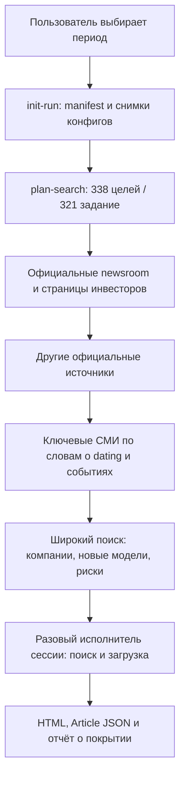

# Сбор и сохранение новостей: состояние и устройство поиска

Проверено 15 ноября 2026. Этот отчёт описывает локальный код и конфиги; сведения о компаниях приведены как настройки мониторинга, а не как новые утверждения о рынке.

## Что реализовано в основном приложении

CLI содержит команды `init-run`, `plan-search` и `archive-articles`. Постоянный архив с проверкой ID/URL/текста описан в [article-archive.md](article-archive.md). Первая фиксирует выбранный период, манифест и семь конфигов; вторая строит воспроизводимый план и проверяет отпечатки снимков. Автономного поиска, загрузки статей и исполнения промптов в `src/` пока нет. `retrieval.search_provider` равен `null`; параметры повторов, тайм-аута и перекрытия заданы в конфиге, но основная программа их ещё не исполняет.

На момент начала проверки в `data/` находились три старых тестовых манифеста версий 0.1–0.3, один старый поисковый план и ни одной сохранённой статьи. До добавления постоянного архива проходили 33 теста; теперь **50 unittest проходят**, `git diff --check` проходит. Тесты проверяют подготовку запуска и постоянный архив (дубли, версии, даты, конкурентную запись и восстановление), а не полноту реального сетевого сбора. Старый `docs/audit.md` упоминает 27 тестов и в этой части устарел.

Пользователь выбрал разовый сбор в этой сессии за **1–14 ноября 2026 включительно**, Москва. Запуск: `data/runs/20261115T000000+0300_c85bf605/`. Он использует инструменты веб-поиска сессии и отдельный локальный сценарий `.tmp/collect_session.py`; это не новый автономный провайдер основного приложения. Результаты и ограничения зафиксированы в отчёте самого запуска `collection_report.md`. Результат: 45 карточек, из них 43 с датой в выбранном окне (33 full, 10 partial) и 2 с неясной датой; 338 целей поиска исполнены, 99 URL обработаны, 21 загрузка завершилась ошибкой. Все 12 обязательных компаний упоминаются в сохранённых материалах. Это не подтверждение полноты RU/EN, всех страниц выдачи или новизны каждого события. Из 1034 наблюдаемых URL 957 не скачивались после отбора доменов/признаков свежести; возможные пропуски не исследованы. В каждом из 10 эталонных кейсов сохранён хотя бы один исходный URL, но эти ссылки использовались как seeds и не измеряют независимый recall.

Основной корпус также сохранён в общем `article/2026/11/DD.MM.YY/`: 43 датированные карточки и две в `_undated`. Файлы запуска остаются снимком для исторических ссылок. При новых сохранениях проверяются ID, URL и текст; существующие JSON не перезаписываются.

## Как строится поиск

Связь основного приложения заканчивается на плане: последние два узла выполнены отдельным разовым сценарием. Наличие запланированного запроса не считается выполненным поиском.

Текущий план содержит 26 целей для официальных источников, 5 для обзора ключевых СМИ, 269 брендовых целей, 36 для обнаружения новых моделей и 2 для рисков. Одинаковые тексты объединяются в 321 задание, но остаются 338 языковых вариантов до оптимизации конкретным провайдером. Это не оценка конечного числа сетевых запросов: отдельно нужны пагинация, уточнения и загрузка страниц.

Базовая формула: `(название OR алиас OR алиас) [AND (уточняющий dating-контекст)]`. Дополнительная тематическая формула добавляет `AND (ключевая фраза OR другая фраза)`. Внутри группы используется OR, между группами — AND. Базовый брендовый запрос не требует запуска или новой функции и поэтому сохраняет возможность найти финансовые результаты, исследования и назначения.

Официальный запрос имеет вид `site:домен (названия и алиасы связанных компаний)`. Генератор использует hostname, а не путь newsroom, и сам страницу не открывает. Один IR-запрос может покрывать несколько брендов: например, Match Group, Tinder и Hinge. Официальное сообщение не отменяет поиск в СМИ.

Даты сохраняются отдельно в manifest; поисковому API их должен передавать исполнитель. Ограничение поисковой выдачи по датам не заменяет проверку даты публикации на странице. Дата публикации, дата события и время загрузки — разные поля. Неизвестная дата требует проверки.

Контекст Lovito/Gate 2 не формирует запросы и не меняет отбор: он предназначен для последующего блока so what.

## Компании, имена и глубина поиска

Всего включены 27 компаний и связанных организаций. Обязательные 12 — первая пятёрка, четыре основных участника эталонных примеров и три смежные организации. Остальные тоже включены в текущий план, но не защищены от отключения как обязательные.

| Группа | Поиск по компании |
|---|---|
| always | Базовый RU/EN + все семь тем + официальные источники |
| golden_set | Базовый RU/EN + все семь тем + официальные источники; для Liangpei дополнительно ZH-базовый запрос |
| golden_adjacent | Базовый RU/EN с уточнением контекста + связанные официальные источники; отдельных тематических запросов нет |
| russia | Базовый RU/EN + все семь тем + официальные источники |
| international | Базовый RU/EN + официальный источник; отдельных тематических запросов нет |
| mechanism_watch | Базовый RU/EN + новые модели, монетизация, AI + официальный источник |

| Компания | Дополнительные имена в конфиге | Группа | Языки брендового поиска |
|---|---|---|---|
| Tinder | Tinder, Тиндер | always | ru/en |
| Badoo | Badoo, Баду | always | ru/en |
| Bumble | Bumble, Бамбл | always | ru/en |
| Hinge | Hinge, Хиндж | always | ru/en |
| Grindr | Grindr, Гриндр | always | ru/en |
| Match Group | Match Group, MTCH | golden_set | ru/en |
| PURE | PURE, Pure app, Пьюр | golden_set | ru/en |
| Liangpei AI | Liangpei, Liangpei AI, 良配 | golden_set | ru/en/zh |
| World / World ID | World ID, Worldcoin, Tools for Humanity | golden_set | ru/en |
| Freddie / PurposeMed | Freddie, PurposeMed | golden_adjacent | ru/en |
| Ithaca Holdco / Ithaca Holdings | Ithaca Holdco, Ithaca Holdings | golden_adjacent | ru/en |
| The Harris Poll | Harris Poll, The Harris Poll | golden_adjacent | ru/en |
| Мамба / Mamba | Мамба, Mamba | russia | ru/en |
| Twinby | Twinby, Твинби | russia | ru/en |
| VK Знакомства | VK Знакомства, ВК Знакомства, VK Dating | russia | ru/en |
| Teamo | Teamo, Теамо | russia | ru/en |
| LovePlanet | LovePlanet, ЛавПланет | russia | ru/en |
| Feeld | Feeld, Филд | international | ru/en |
| happn | happn, Хаппн | international | ru/en |
| Coffee Meets Bagel | Coffee Meets Bagel, CMB dating | international | ru/en |
| Pairs | Pairs, ペアーズ | international | ru/en |
| tapple | tapple, タップル | international | ru/en |
| Hily | Hily, Хайли | international | ru/en |
| Boo | Boo | international | ru/en |
| Breeze | Breeze | mechanism_watch | ru/en |
| Thursday | Thursday, Thursday dating | mechanism_watch | ru/en |
| Sitch | Sitch | mechanism_watch | ru/en |
Для PURE добавляется «знакомства/приложение» или `dating/app`; для World — dating/Tinder/верификация; для Freddie — Grindr; для Ithaca — Bumble; для Harris Poll — dating/World; для Pairs — dating/Japan. Boo, Breeze, Thursday и Sitch также имеют уточняющий контекст. Эти условия нужны для отсечения одноимённых несвязанных объектов.

Juno, Within Social, CrowdMatch, Fledge и Overtone сохранены отдельно в `config/discovery_candidates.json`. Сейчас генератор этот файл не читает: они **не получают собственного обязательного брендового мониторинга**, хотя могут обнаруживаться открытыми запросами. Автоматического добавления новых компаний в каталог ещё нет.

## Все семь семейств тематических фраз

Это полные списки текущего `config/queries.json`, а не сокращённые примеры.

| Тема | RU | EN |
|---|---|---|
| features | новая функция, запуск, тест, раскатка, новый рынок, обновление | new feature, launch, pilot, rollout, market expansion, product update |
| monetization | подписка, тариф, цена, платный пакет, комиссия, премиум | subscription, pricing, paid tier, package, fee, premium |
| trust_safety | верификация, проверка документов, проверка лица, антифрод, мошенничество, харассмент, депозит, гарантия, страхование | verification, identity check, face verification, fraud, scam, harassment, deposit, guarantee, insurance |
| ai | AI, ИИ, ассистент, автозаполнение, подбор, скоринг, модерация, AI-агенты | AI, assistant, profile completion, matching, scoring, moderation, AI agents |
| new_models | новая модель, новое приложение, стартап, пилот, раунд, гарантия возврата | business model, new dating app, startup, pilot, funding, money-back guarantee |
| business | финансовые результаты, выручка, платящие, сделка, поглощение, назначение, партнёрство | earnings, revenue, paying users, acquisition, merger, appoints, partnership |
| marketing | кампания, реклама, продвижение, опрос, бренд, исследование | campaign, advertising, promotion, survey, brand, research |
## Поиск новых компаний и механик

Этот поиск не требует заранее известного бренда. Формула: `(dating-контекст) AND (механика) AND (сигнал новизны)`. Кроме неё есть широкий запрос без заранее заданной механики.

Dating-контекст RU: приложение знакомств, сервис знакомств, дейтинг, матчмейкинг. EN: dating app, dating startup, matchmaking app.

Сигналы новизны RU: запуск, новый, пилот, тест, инвестиции, раунд. EN: launch, new, pilot, beta, funding, seed.

| Направление | RU | EN |
|---|---|---|
| Оплата за состоявшееся свидание | оплата за свидание, плата за встречу | pay per date, pay-per-date |
| Оплата за результат и гарантия возврата | гарантия брака, возврат денег, оплата за результат | marriage guarantee, money-back guarantee, success fee |
| Депозиты и защита от неявок | депозит, штраф за неявку, бронь свидания | deposit, no-show fee, commitment fee |
| Один кандидат и ограниченный подбор | один кандидат, один матч, без свайпов | one match at a time, curated matching, swipe-free |
| AI плюс человек-сваха | AI-сваха, AI-интервью, AI-подбор | AI matchmaker, AI interview, human matchmaking |
| Друзья и групповые знакомства | друзья подбирают пару, групповые знакомства, двойное свидание | friend matchmaking, group dating, double date |
| Офлайн-встречи и партнёрства с заведениями | офлайн-свидания, знакомства в барах, билеты на знакомства | offline dating, singles events, venue partnership |
| Проверка личности и семейного статуса | проверка семейного положения, подтверждение личности, проверка холост | single status verification, identity-verified dating, proof of personhood |
| Сегментные тарифы и правила контакта | женская подписка, платный первый контакт, тариф для женщин | women subscription, pay to message, gender-based pricing |
| Нишевые сообщества и приглашения | нишевые знакомства, по приглашениям, клуб знакомств | niche dating, invite-only dating, dating community |
| Голосовые и видеоформаты | голосовые знакомства, видеосвидание, анонимные знакомства | voice-first dating, video dating, anonymous dating |
| Партнёрская и субсидируемая модель | знакомства для сотрудников, субсидируемые знакомства, корпоративные знакомства | employer dating benefit, subsidized dating, B2B matchmaking |
| Сервисы вокруг свиданий | маркетплейс свиданий, партнёрство с рестораном, консьерж свиданий | dating concierge, date marketplace, restaurant partnership |
| Государственные и некоммерческие модели | государственный сервис знакомств, некоммерческие знакомства | government dating app, nonprofit dating app |

Дополнительные запросы на китайском и японском:

- zh: `("相亲" OR "婚恋") ("AI" OR "退款" OR "商业模式") ("上线" OR "融资")`.
- ja: `("マッチングアプリ" OR "婚活") ("新機能" OR "開始" OR "料金")`.

Отдельные запросы о рисках:

- ru: `("сайт знакомств" OR "приложение знакомств") ("мошенники" OR "вредонос" OR "APK" OR "установить приложение")`.
- en: `("dating app" OR "romance scam") ("malware" OR "APK" OR "app installation" OR "fraud warning")`.

Отраслевые seeds: Global Dating Insights, Dating Industry Insights, TechCrunch, 36Kr. Для них генератор добавляет поиск по `dating startup`, `new dating app`, `matchmaking launch`.

Гороскопы, `dating tips` и `celebrity gossip` — мягкие сигналы шума. Глобальные минус-слова в запросы автоматически не добавляются: они могли бы отсечь полезную кампанию или исследование.

## Источники и специальные ключевые слова СМИ

В реестре 34 включённые записи. Порядок: официальные newsroom/IR → остальные официальные источники → пять ключевых СМИ → открытый поиск.

Ключевые СМИ: TechCrunch, Global Dating Insights, Dating Industry Insights, 36Kr и «Ведомости». Их формула: `site:домен (dating-контекст) (ключевые слова СМИ)`.

Ключевые слова СМИ RU: запуск, функция, подписка, тариф, верификация, AI, выручка, сделка, назначение, кампания, опрос.

Ключевые слова СМИ EN: launch, feature, subscription, pricing, verification, AI, earnings, acquisition, appointment, campaign, survey.

NEWS.ru, Новости Mail и Panabee находятся в реестре, однако генератор не создаёт им отдельные site-запросы. Их ссылки из эталонных примеров также пока не превращаются основным приложением в задания загрузки. Разовый сценарий использует эти ссылки как дополнительные seeds с отдельной проверкой дат; это не измерение поискового recall эталона.

Официальный домен Liangpei пока не определён — компания всё равно участвует в поиске. Для Freddie и Ithaca предусмотрены первичные сообщения партнёров. Включённый источник не означает, что его полный текст доступен или уже поддержан парсером.

## Что считать результатом этого этапа

Для каждого запуска нужны: журнал реально выполненных запросов; исходные страницы либо явные ошибки; карточки Article с URL, заголовком, языком, датой и её точностью, текстом и статусом извлечения, временем загрузки и хешем; связь результатов с целями поиска; сводка покрытия и список нерешённых случаев. Неизвестная дата не превращается в известную, сбой источника не превращается в ноль новостей. Лимит top-10 на сбор не распространяется.

Дубли URL/канонического URL следует объединять; одинаковые тексты разных страниц надо помечать. Объединение публикаций в одно событие относится к следующему редакционному этапу.

Для закрытия автономной версии ещё нужны: исполнитель поискового API с поддержкой синтаксиса и фильтров; пагинация и учёт бюджета; загрузка и извлечение текста с валидацией Article; восстановление после сбоя; фактическое покрытие и отдельная проверка исторического эталона. Одного ключа API для этого недостаточно — соответствующего кода ещё нет.

## Что требуется от пользователя

Для выбранного разового сбора период и способ работы уже определены; ключи API, LLM, бот, канал доставки и расписание для него не нужны. Следующий пользовательский шаг — посмотреть сохранённый корпус и пробелы, отражённые в `collection_report.md`.

Для перехода к автономному сбору потребуется выбрать доступный поисковый API и лимит расходов, затем настроить его ключ в локальном окружении. По умолчанию материалы можно продолжить хранить локально в существующей структуре `data/runs/`; выбор базы данных не является условием пилота. Решения по LLM, рассылке и расписанию относятся к следующим этапам.
